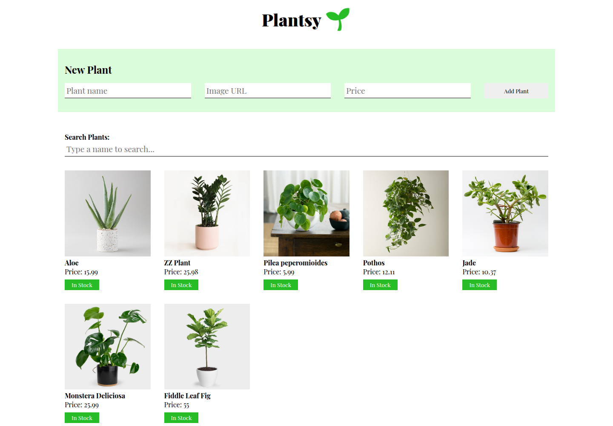

# Plantsy

Plantsy is a small plant shop manager. It loads plants from a local JSON API
and lets you add plants, mark them as sold out, and search by name.

## Features

- View the plants loaded from the backend when the app starts.
- Add a plant with its name, image URL, and price.
- Mark an in-stock plant as sold out; the change is saved to the backend.
- Filter the plant list by name. Clearing the search shows all plants again.

## Screenshot



## Getting started

Requirements: Node.js and npm.

Install dependencies:

```sh
npm install
```

In separate terminals, start the JSON Server backend and the Vite frontend:

```sh
npm run server
```

```sh
npm run dev
```

Open the local URL printed by Vite (typically http://localhost:5173). The API
is available at http://localhost:6001/plants.

## Tests

Run the test suite once:

```sh
npm run test -- --run
```

## API

The app uses the JSON Server API at `http://localhost:6001`:

| Method | Endpoint | Purpose |
| --- | --- | --- |
| `GET` | `/plants` | Load all plants |
| `POST` | `/plants` | Create a plant |
| `PATCH` | `/plants/:id` | Set `{ "soldOut": true }` |

Plant records have a `name`, `image`, and `price`; JSON Server assigns each
record an `id`. The sold-out state is stored as `soldOut: true`.
